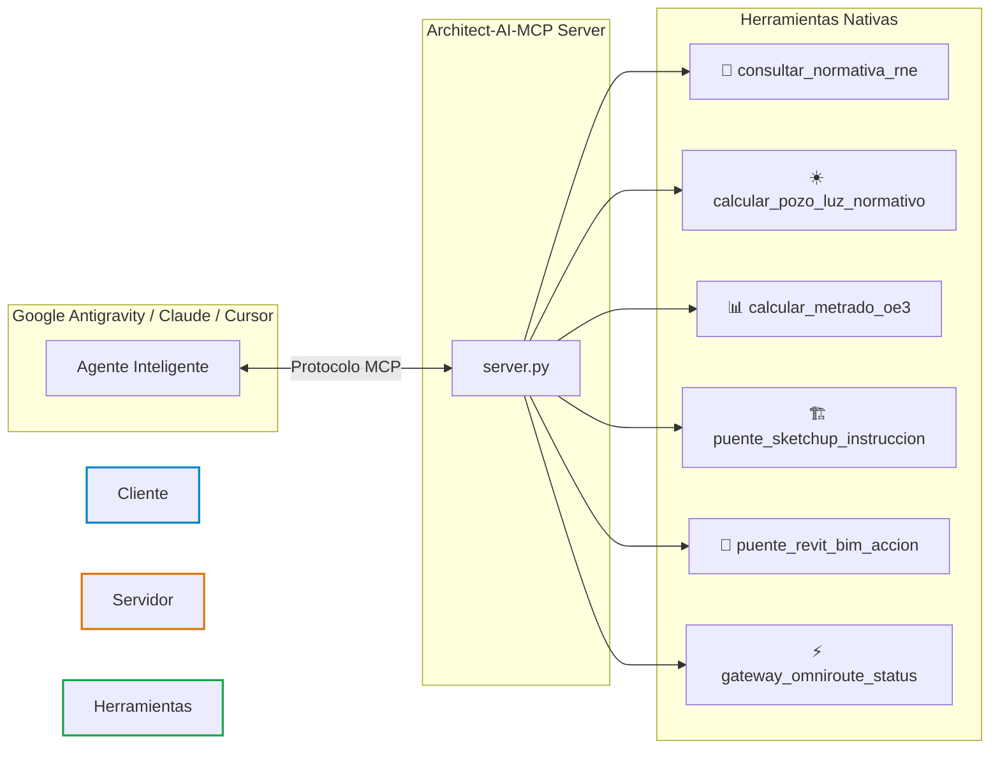

# 🏛️ Architect AI — Model Context Protocol (MCP) Server
### Servidor MCP de Arquitectura, BIM 5D, Normativa RNE y Modelado 3D Paramétrico
**Autor y Desarrollador:** Mg. Arq. Juan Miguel Angulo García ([@MickyAngs](https://github.com/MickyAngs))  
**Licencia:** MIT | **Arquitectura:** FastMCP Python + OmniRoute Gateway

---

```
   █████╗ ██████╗  ██████╗██╗  ██╗██╗████████╗███████╗ ██████╗████████╗     ███╗   ███╗ ██████╗██████╗ 
  ██╔══██╗██╔══██╗██╔════╝██║  ██║██║╚══██╔══╝██╔════╝██╔════╝╚══██╔══╝     ████╗ ████║██╔════╝██╔══██╗
  ███████║██████╔╝██║     ███████║██║   ██║   █████╗  ██║        ██║        ██╔████╔██║██║     ██████╔╝
  ██╔══██║██╔══██╗██║     ██╔══██║██║   ██║   ██╔══╝  ██║        ██║        ██║╚██╔╝██║██║     ██╔═══╝ 
  ██║  ██║██║  ██║╚██████╗██║  ██║██║   ██║   ███████╗╚██████╗   ██║   ██╗  ██║ ╚═╝ ██║╚██████╗██║     
  ╚═╝  ╚═╝╚═╝  ╚═╝ ╚═════╝╚═╝  ╚═╝╚═╝   ╚═╝   ╚══════╝ ╚═════╝   ╚═╝   ╚═╝  ╚═╝     ╚═╝ ╚═════╝╚═╝     
```

---

## ⚡ ¿Qué es Architect AI MCP?

**Architect AI MCP** es un servidor open-source diseñado bajo el estándar abierto **Model Context Protocol (MCP)** que dota a cualquier agente de Inteligencia Artificial (Google Antigravity, Claude Desktop, Cursor, Roo-Code) de herramientas nativas para **diseño arquitectónico, validación técnica, cómputos métricos y puentes 3D/BIM**.

Está especialmente optimizado para **laptops de 8 GB de RAM**, utilizando una arquitectura de consumo ultraligero (<35 MB RAM) mediante el gateway **OmniRoute**.

---

## 🛠️ Herramientas Integradas en el Servidor



### 1. 📐 Normativa Técnica y Confort
* `consultar_normativa_rne(norma, tema)`: Consulta instantánea de parámetros de las normas A.010, EM.110 (confort térmico/lumínico) y G.050 (seguridad).
* `calcular_pozo_luz_normativo(pisos, entrepiso, tipo_ambiente)`: Calcula diámetros inscritos, lados mínimos y áreas reglamentarias de ventilación.

### 2. 📊 Cómputos Métricos y Costos OE.3
* `calcular_metrado_oe3(partida, descripcion, largo, ancho, alto, cantidad)`: Extrae metrados de muros (m²), revoques (m²), pisos (m²) y concreto estructural (m³) según la Norma Técnica de Metrados.

### 3. 🏗️ Modelado 3D y Automatización BIM
* `puente_sketchup_instruccion(ruby_code, descripcion)`: Genera y valida scripts Ruby para Trimble SketchUp vía MCP.
* `puente_revit_bim_accion(categoria, parametros, accion)`: Estructura llamadas nativas para Autodesk Revit (2022 al 2027) vía `rvt-mcp`.

### 4. ⚡ Enrutamiento Zero-RAM (Laptops 8 GB)
* `gateway_omniroute_status()`: Conecta con el proxy local en `http://localhost:20128/v1` para ejecutar modelos cloud (Gemini, DeepSeek, Qwen) sin congelar la computadora.

---

## 🚀 Instalación y Puesta en Marcha (1 Clic)

### Paso 1: Clonar el Repositorio
```bash
git clone https://github.com/MickyAngs/Architect-AI-MCP.git
cd Architect-AI-MCP
```

### Paso 2: Instalar Dependencias
```bash
pip install -r requirements.txt
```

### Paso 3: Integrar en tu Entorno (Antigravity / Cursor / Claude)
Copia el contenido de `mcp_config.json` en la configuración de servidores MCP de tu editor:

```json
{
  "mcpServers": {
    "architect-ai-mcp": {
      "command": "python",
      "args": ["/ruta/absoluta/a/Architect-AI-MCP/server.py"]
    }
  }
}
```

---

## 💬 Ejemplos de Uso con el Agente

* *"Agente, calcula el pozo de luz mínimo para un edificio residencial de 5 pisos con entrepisos de 2.80 m."*
* *"Agente, extrae el metrado de muros de ladrillo soga de 12.50 m de largo por 2.60 m de alto."*
* *"Agente, verifica la altura mínima de entrepiso según la norma A.010 del RNE."*
* *"Agente, genera la instrucción para levantar una volumetría de 3 niveles en SketchUp."*

---

## 👤 Autor
**Mg. Arq. Juan Miguel Angulo García**  
* Arquitecto (CAP 6915) & Especialista en IA Agéntica para Arquitectura y Construcción.
* GitHub: [@MickyAngs](https://github.com/MickyAngs)
