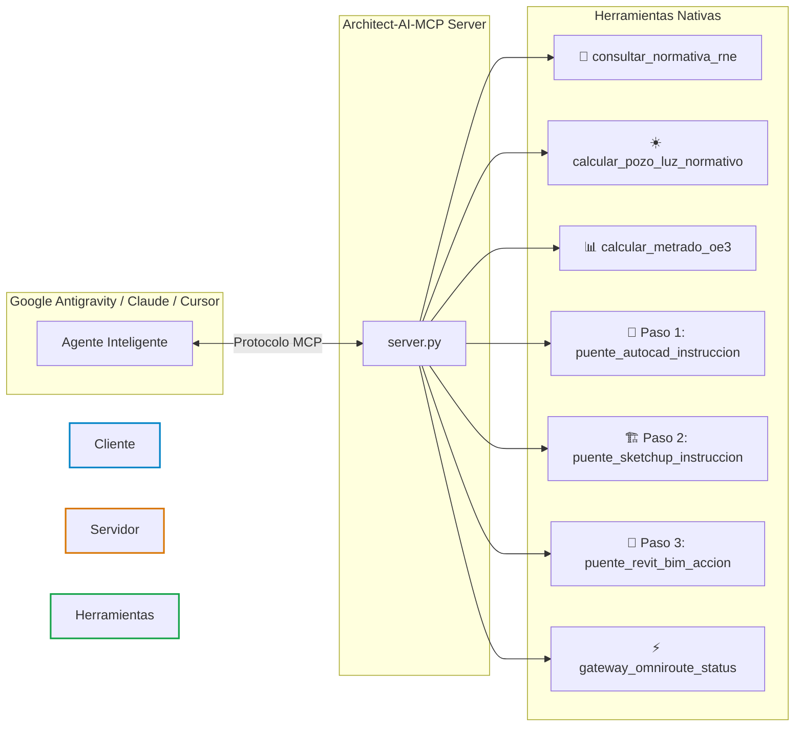

# 🏛️ Architect AI — Model Context Protocol (MCP) Server
### Servidor MCP de Arquitectura, BIM 5D, Normativa RNE y Modelado 3D Paramétrico
**Autor y Desarrollador:** Mg. Arq. Juan Miguel Angulo García ([@MickyAngs](https://github.com/MickyAngs))  
**Licencia:** MIT | **Arquitectura:** FastMCP Python + OmniRoute Gateway

---

```
   █████╗ ██████╗  ██████╗██╗  ██╗██╗████████╗███████╗ ██████╗████████╗     ███╗   ███╗ ██████╗██████╗ 
  ██╔══██╗██╔══██╗██╔════╝██║  ██║██║╚══██╔══╝██╔════╝██╔════╝╚══██╔══╝     ████╗ ████║██╔════╝██╔══██╗
  ███████║██████╔╝██║     ███████║██║   ██║   █████╗  ██║        ██║        ██╔████╔██║██║     ██████╔╝
  ██╔══██║██╔══██╗██║     ██╔══██║██║   ██║   ██╔══╝  ██║        ██║        ██║╚██╔╝██║██║     ██╔═══╝ 
  ██║  ██║██║  ██║╚██████╗██║  ██║██║   ██║   ███████╗╚██████╗   ██║   ██╗  ██║ ╚═╝ ██║╚██████╗██║     
  ╚═╝  ╚═╝╚═╝  ╚═╝ ╚═════╝╚═╝  ╚═╝╚═╝   ╚═╝   ╚══════╝ ╚═════╝   ╚═╝   ╚═╝  ╚═╝     ╚═╝ ╚═════╝╚═╝     
```

---

## ⚡ ¿Qué es Architect AI MCP?

**Architect AI MCP** es un servidor open-source diseñado bajo el estándar abierto **Model Context Protocol (MCP)** que dota a cualquier agente de Inteligencia Artificial (Google Antigravity, Claude Desktop, Cursor, Roo-Code) de herramientas nativas para **diseño arquitectónico, validación técnica, cómputos métricos y puentes 3D/BIM**.

Está especialmente optimizado para **laptops de 8 GB de RAM**, utilizando una arquitectura de consumo ultraligero (<35 MB RAM) mediante el gateway **OmniRoute**.

---

## 🛠️ Herramientas Integradas en el Servidor



### 1. 📐 Normativa Técnica y Confort
* `consultar_normativa_rne(norma, tema)`: Consulta instantánea de parámetros de las normas A.010, EM.110 (confort térmico/lumínico) y G.050 (seguridad).
* `calcular_pozo_luz_normativo(pisos, entrepiso, tipo_ambiente)`: Calcula diámetros inscritos, lados mínimos y áreas reglamentarias de ventilación.
* `consultar_estandar_capas_semanticas()`: Reglas de estandarización obligatoria de capas CAD para modelado 3D y BIM sin errores.

---

## ⚠️ Estándar Obligatorio de Capas Semánticas CAD-BIM

> **REGLA DE ORO DEL MODELADO AGÉNTICO:**  
> Queda terminantemente prohibido utilizar capas por **plumillas de ploteo** (`1`, `2`, `8`, etc.). La inteligencia artificial no adivina intenciones de dibujo; requiere **semántica arquitectónica**. Si un plano mezcla rieles de mampara o mobiliario dentro de la capa de muros, el agente extruirá muros ciegos erróneos.

| Capa CAD Obligatoria | Significado Constructivo | Altura / Tratamiento en SketchUp y Revit |
| :--- | :--- | :--- |
| **`MUROS_ALTOS`** | Muros perimetrales y tabiques completos | Se extruyen sólidos a **$h = 2.60\text{ m}$** (piso a techo). |
| **`MUROS_BAJOS`** | Alféizares de ventanas, antepechos y parapetos | Se extruyen a **$h = 0.90\text{ m}$ a $1.00\text{ m}$**. |
| **`COLUMNAS`** | Placas y columnas estructurales | Se extruyen sólidas a **$h = 2.60\text{ m}$**. |
| **`MAMPARAS`** | Puertas corredizas y divisiones de vidrio | No se extruyen como muro ciego; marco perimetral y paño translúcido. |
| **`PUERTAS`** | Puertas batientes interiores y principales | Vano libre de paso a **$2.10\text{ m}$** de altura. |
| **`VENTANAS`** | Ventanas de iluminación/ventilación | Vano entre el alféizar ($1.00\text{ m}$) y el dintel ($2.10\text{ m}$). |
| **`LOSAS`** | Losas de piso, entrepiso y azotea | Extrusión horizontal de **$0.20\text{ m}$** de espesor. |

---

### 2. 📊 Cómputos Métricos y Costos OE.3
* `calcular_metrado_oe3(partida, descripcion, largo, ancho, alto, cantidad)`: Extrae metrados de muros (m²), revoques (m²), pisos (m²) y concreto estructural (m³) según la Norma Técnica de Metrados.

### 3. 🎯 La Triple Corona del Modelado Arquitectónico (Por Pasos)
* **Paso 1 · 📏 AutoCAD 2D (`puente_autocad_instruccion`):** Genera entidades paramétricas 2D (polilíneas, ejes, capas, cotas) y scripts AutoLISP ejecutables en Autodesk AutoCAD (2020 a 2027) vía COM/multiCAD.
* **Paso 2 · 🏗️ SketchUp 3D (`puente_sketchup_instruccion`):** Genera instrucciones en Ruby API para levantar volumetrías de masa, extrusiones de plantas y maquetas conceptuales directamente en Trimble SketchUp vía MCP sin usar el mouse.
* **Paso 3 · 🏢 Revit BIM 5D (`puente_revit_bim_accion`):** Estructura llamadas nativas para el servidor `rvt-mcp` en Autodesk Revit (2022 al 2027) para crear niveles, rejillas, muros constructivos, habitaciones, tablas de metrados OE.3 y láminas.

### 4. ⚡ Enrutamiento Zero-RAM (Laptops 8 GB)
* `gateway_omniroute_status()`: Conecta con el proxy local en `http://localhost:20128/v1` para ejecutar modelos cloud (Gemini, DeepSeek, Qwen) sin congelar la computadora.

---

## 🚀 Instalación y Puesta en Marcha (1 Clic)

### Paso 1: Clonar el Repositorio
```bash
git clone https://github.com/MickyAngs/Architect-AI-MCP.git
cd Architect-AI-MCP
```

### Paso 2: Instalar Dependencias
```bash
pip install -r requirements.txt
```

### Paso 3: Integrar en tu Entorno (Antigravity / Cursor / Claude)
Copia el contenido de `mcp_config.json` en la configuración de servidores MCP de tu editor:

```json
{
  "mcpServers": {
    "architect-ai-mcp": {
      "command": "python",
      "args": ["/ruta/absoluta/a/Architect-AI-MCP/server.py"]
    }
  }
}
```

---

## 💬 Ejemplos de Prompts por Pasos
* **Paso 1 (AutoCAD 2D):** *"Agente, en AutoCAD crea la capa A-MUROS en color blanco y dibuja el perímetro del terreno de 10.00 x 20.00 metros con una polilínea cerrada."*
* **Paso 2 (SketchUp 3D):** *"Agente, levanta la volumetría preliminar en SketchUp de 3 niveles con alturas de entrepiso de 3.00 m y agrúpalo."*
* **Paso 3 (Revit BIM 5D):** *"Agente, en Revit crea los niveles Nivel 1 (+0.00), Nivel 2 (+3.20) y traza la grilla de ejes estructurales de 5x5 metros."*
* **Auditoría RNE:** *"Agente, calcula el pozo de luz normativo según RNE A.010 para un edificio multifamiliar de 5 pisos."*
* **Metrados OE.3:** *"Agente, extrae el metrado normativo de muros de albañilería (OE.3.1) para 4 tramos de 12.50 m de largo por 2.60 m de alto."*

---

## 👤 Autor
**Mg. Arq. Juan Miguel Angulo García**  
* Arquitecto (CAP 6915) & Especialista en IA Agéntica para Arquitectura y Construcción.
* GitHub: [@MickyAngs](https://github.com/MickyAngs)
